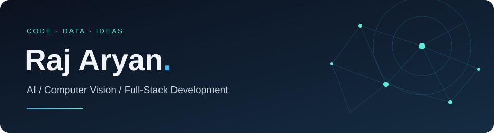
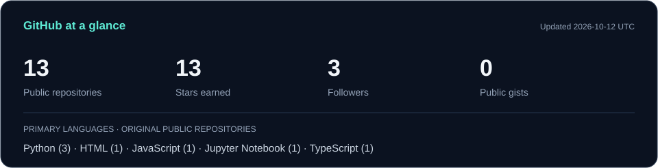

### Hi, I'm Raj 👋

I build across **AI, computer vision, and web development** — from repository analysis tools to practical automation projects.

  

[About](#about-me) · [Projects](#selected-projects) · [Tech stack](#tech-stack) · [GitHub stats](#github-stats)

## About me

I'm Raj Aryan. My projects bring together software development, data, and AI to solve practical problems.

- **AI & computer vision:** repository analysis, agentic AI, player re-identification, and image processing.
- **Web & automation:** React-based applications, Python tooling, and browser automation.
- **Beyond the web:** mobile development with Flutter and Dart, and hardware experiments with Arduino.

I'm happy to connect with people working on AI, web apps, and useful developer tools. [Get in touch →](mailto:rajaryan.edu25@gmail.com)

## Selected projects

| Project | What it does |
| :--- | :--- |
| **[RepoLens](https://github.com/raj-aryan25/rapunzel)** | An AI-powered GitHub repository analyzer with project summaries, technical insights, and resume-ready bullet points. Built with Next.js, React, and Gemini. |
| **[OP-AI](https://github.com/raj-aryan25/OP-AI)** | An agentic AI copilot for battery swap stations. |
| **[Soccer Player Re-identification](https://github.com/raj-aryan25/soccer-player-reid)** | A computer vision project for player re-identification in a single video feed. |
| **[School Nutritionist](https://github.com/raj-aryan25/School-Nutritionist)** | A Python project that calculates nutrient intake and identifies potential deficiencies from food intake data. |

[Explore all my repositories →](https://github.com/raj-aryan25?tab=repositories)

## Tech stack

### Languages

     

### Web, mobile & APIs

        

### AI, data & computer vision

      

### Databases, cloud & tools

       

<strong>Design & hardware</strong>

 

  

## GitHub stats

Public GitHub snapshot; the card shows its last refresh date. Stars and language counts cover original repositories; languages count repositories by their primary language, not proficiency.

<!-- To refresh the stats card: run node scripts/update-stats.mjs (Node.js 22+), then commit the updated SVG. -->

[View my contribution activity →](https://github.com/raj-aryan25?tab=overview)

---

**Have a project in mind? Let's connect.**

[LinkedIn](https://www.linkedin.com/in/rajaryan-r25/) · [Email](mailto:rajaryan.edu25@gmail.com) · [Instagram](https://www.instagram.com/rajaryan25dec05/)

